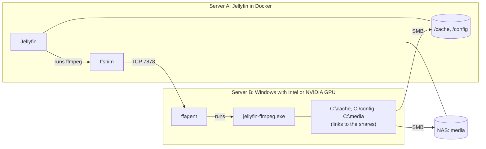

# Agent on another Windows machine

The shim and agent talk over plain TCP, so Jellyfin can run on one machine
(for example a Linux server or NAS running Docker) and ffmpeg on another
Windows machine with an Intel or NVIDIA GPU. For a Linux GPU machine, see
[Agent on a Linux machine](linux-agent.md) instead.



**What changes compared to one machine:**

1. The shim connects to the Windows machine's IP instead of `host.docker.internal`.
2. Windows can no longer see the files directly. Every folder the Jellyfin
   container uses must be reachable from Windows over the network (SMB), and
   linked at the same path. The agent creates the links; you provide the shares.
3. ffmpeg on Windows **writes** the transcoded segments into Jellyfin's
   `/cache`, so that share must be writable from Windows and readable by Jellyfin.

## Network and performance

- Windows reads the source file over the network: a 4K remux peaks around
  80–150 Mbit/s. Wired gigabit is recommended for 4K; Wi-Fi is not.
- Output segments go back over SMB, which is small compared to the input.
- Latency adds a little to playback start; it doesn't affect smoothness.

## Security

The token never crosses the network (challenge/response), so nobody can use
the agent without it. **The connection is not encrypted**, however: file paths
and ffmpeg output are readable on the wire. Use it on a trusted home LAN, or
put both machines on WireGuard or Tailscale and use those IPs.

## Setup

### 1. Share Jellyfin's folders with Windows (server A)

Share at least the folders behind `/cache` and `/config`, plus any media that
isn't already on a NAS Windows can reach. Example Samba config on a Linux host
where the compose file uses `./cache:/cache` and `./config:/config` in
`/opt/jellyfin`:

```ini
# /etc/samba/smb.conf
[jellyfin-cache]
   path = /opt/jellyfin/cache
   read only = no
   valid users = jellyfin-smb
   # Files written by Windows must be usable by Jellyfin: write them as the
   # user that owns the folder (root for the default image, or your `user:` uid).
   force user = root

[jellyfin-config]
   path = /opt/jellyfin/config
   read only = no
   valid users = jellyfin-smb
   force user = root
```

```sh
sudo useradd -M -s /usr/sbin/nologin jellyfin-smb
sudo smbpasswd -a jellyfin-smb
sudo systemctl restart smbd
```

### 2. Install the agent (server B, Windows)

Follow the main [setup](../README.md#setup-windows-host) steps 1–3, but run install **without**
`--compose`. Your compose file is on the other machine and its paths don't
apply here (add `--gpu nvidia` for an NVIDIA GPU):

```powershell
.\ffagent.exe install
```

Then edit `C:\ProgramData\ffagent\ffagent.conf` with Notepad (as Administrator)
and list **every** volume of the Jellyfin container, pointing at the shares:

```ini
[paths]
/cache  = \\server-a\jellyfin-cache
/config = \\server-a\jellyfin-config
/media  = \\nas\media

[credentials]
\\server-a\jellyfin-cache  = jellyfin-smb:the-password
\\server-a\jellyfin-config = jellyfin-smb:the-password
\\nas\media                = mediauser:another-password
```

The agent runs as SYSTEM, which has no saved network passwords, so it logs on
to the shares itself using `[credentials]`. Then:

```powershell
C:\ProgramData\ffagent\ffagent.exe restart
C:\ProgramData\ffagent\ffagent.exe status
```

Every path must show `ok`. Note the token: `ffagent token`.

### 3. Add the shim to Jellyfin (server A)

Clone this repository next to your compose file on server A, copy
[`examples/docker-compose.override.yml`](../examples/docker-compose.override.yml)
next to it, and:

- set `FFSHIM_AGENT: <windows-ip>:7878` (uncomment the line);
- the `extra_hosts` lines can stay; they are harmless;
- put the token in `.env`: `FFSHIM_TOKEN=...`.

```sh
docker compose up -d --build
docker exec jellyfin /opt/ffshim/ffmpeg -ffshim-ping
```

Then apply the [Jellyfin settings](../README.md#5-jellyfin-settings) and
[verify](../README.md#6-verify-it-works).

## Firewall

`ffagent install` allows ports 7878/7879 from the **local subnet** only. If
Jellyfin or Home Assistant connects from another subnet or over a VPN, widen
the rule (Administrator terminal):

```powershell
netsh advfirewall firewall set rule name="ffagent (Jellyfin ffmpeg agent)" new remoteip=localsubnet,100.64.0.0/10
```

(`100.64.0.0/10` is Tailscale's range; use your own.) Running
`ffagent install` again resets the rule to the local subnet.
